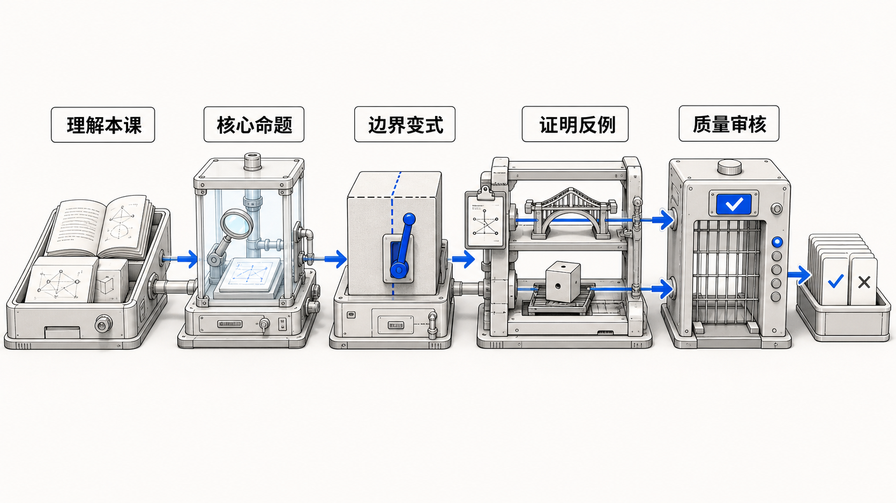

**中文** | [English](README_EN.md)

# 课时先行｜初中数学判断题设计与审核 Skill（v2.1）



> **先吃透这一课讲什么、不讲什么，再围绕关键理解边界写出数学严谨、短小地道、老师站上讲台就能顺口念出来的判断题。**

`lesson-first-judgment-question-sop` 是一个面向中文初中数学单课时的开源 Agent Skill（支持 **Antigravity、Codex、Claude Code** 等主流 Agent 环境）。它可以从课题标题、教师说明、PPT、教材页或教案出发，先生成可核对的**「课时理解卡」**，再默认同时输出**「知识辨析型」**与**「想法辨析型」**两类判断题供教师挑选。

```text
好判断题 = 本课核心正确命题
         + 一个学生真会混淆的边界改变（或反直觉但合法的巧思变形）
         + 课内可执行的简明证明、计算或反例
         + 自然地道的初中课堂汉语
```

---

## v2.1 核心升级亮点

| 传统 AI 出判断题的常见通病 | 本 Skill（v2.1）的解决机制 |
| --- | --- |
| 固定凑满“6 道/8 道”，后几题换数字充数 | **诊断点先行 + 删除测试**：有几个独立边界就出几道，宁缺毋滥 |
| 只考干巴巴的定义背诵，脱离做题现场 | **默认双分支输出**：同时提供「知识辨析型（≤35字）」+「想法辨析型（≤55字）」 |
| 题题排队喊“小明认为……他的想法正确”木偶腔 | **去木偶化规则**：算式/图形直觉题直接写客观推理句，禁用句尾复读尾巴与旁白剧透 |
| 为防抬杠写成 70 字法条说明书、满屏“对任意实数” | **组首一句课堂约定 + 术语白名单**：卸掉单题免责补丁，未学术语零越界 |
| 术语替换闹出“确定事件都是确定会发生的事件”废话 | **防车轱辘话熔断 + 强制「脱稿朗读重写关」**：念着拧巴当场改写或淘汰 |

---

## 你会得到什么

每次运行默认按以下四部分清晰交付（学生题干不用表格承载，可直接粘贴进学习单或课件）：

1. **课时理解卡**：本课主要内容、包含范围、排除范围、证据依据与待核对项（状态 `READY | PENDING_JUDGMENT | INSUFFICIENT_INPUT`）；
2. **学生版（双分支）**：
   - 简短作答导语（按需附一句组首课堂约定，如 `除专门考查取值条件外，题中字母均取使原式有意义的值`）；
   - **第一类：知识辨析型**——聚焦概念、法则、性质的关键条件与适用边界，短句直判；
   - **第二类：想法辨析型**——聚焦具体做题步骤中“依据能否推出结论”，错题抓高频直觉滑坡，`√` 题只考“表面看似犯规、实则合法”的高价值变形；
3. **教师版答案与简析**：逐题给出 `√/×` 及课内简明依据或具体反例；
4. **选用提示**：标注跨组“可二选一”题目对（外加可选的**「单点微变串」**模式，围绕同一公式连续微调打透）。

---

## 五步生成与审核 SOP

```text
课题标题 / 教师说明 / 课件 / 教案
                ↓
        1. 锁定课时理解卡（严守包含与排除边界）
                ↓
        2. 双通道提取独立理解边界（不预设题数、不配平）
                ↓
        3. 设定组首课堂约定 + 起草候选题与课内反例/证明
                ↓
        4. 硬质量门 + 独立「初中老师脱稿朗读重写关」（去法条腔、去木偶腔）
                ↓
        5. 组内认知去重、删除测试与跨组“二选一”标注
```

---

## 30 秒安装与开始使用

克隆或下载本仓库后，将内层的 `lesson-first-judgment-question-sop` 文件夹放入你常用的 Agent 技能目录即可：

### 方式 A：Google Antigravity
```text
Windows: %USERPROFILE%\.gemini\config\skills\lesson-first-judgment-question-sop
macOS/Linux: ~/.gemini/config/skills/lesson-first-judgment-question-sop
```

### 方式 B：Codex CLI / App
```text
Windows: %USERPROFILE%\.codex\skills\lesson-first-judgment-question-sop
macOS/Linux: ~/.codex/skills/lesson-first-judgment-question-sop
```

### 方式 C：Claude Code
```text
Windows: %USERPROFILE%\.claude\skills\lesson-first-judgment-question-sop
macOS/Linux: ~/.claude/skills/lesson-first-judgment-question-sop
```

### 直接对话调用示例

最小输入只需一个课题标题（也可以把当堂 PPT / 教案 / 讲授重点一并拖入）：

```text
请用 lesson-first-judgment-question-sop，根据七年级《中心对称》生成本课判断题（默认输出知识辨析型与想法辨析型，不要凑固定题数）。
```

如果想围绕某一个核心公式做连续变式对比，可指定微变模式：

```text
请用 lesson-first-judgment-question-sop 的「单点微变模式」，围绕平方差公式结构识别出一组紧凑判断题。
```

---

## 真实课例风格示范（v2.1 口语脱敏后）

以下展示本 Skill 在几何对称、分式方程建模与乘法公式课上的典型产出颗粒度：

### 示范 1：《中心对称》（直通中考抽象几何命题）

| 分支 | 学生题干 | 答案 | 课内依据或反例 |
| --- | --- | :---: | --- |
| 知识辨析 | 成中心对称的两个图形，对应线段互相平行且相等。 | × | 对应线段也可能在同一直线上（如对称中心在线段上时）。 |
| 知识辨析 | 把成中心对称的两个图形看成一个整体，这个整体一定是中心对称图形。 | √ | 绕对称中心旋转 180° 后两部分互换位置，整体与原图重合。 |
| 想法辨析 | 等边三角形绕某一点旋转 120° 后能与原来的图形重合，所以它是中心对称图形。 | × | 中心对称图形必须绕某点旋转 180° 后重合。 |
| 想法辨析 | 看到两个三角形的三组边分别平行且相等，就可以断定这两个三角形成中心对称。 | × | 平移得到的两个三角形也满足三组边平行且相等。 |
| 想法辨析 | 已知两个三角形成中心对称，连接一对对称点得到线段 AA′，只取线段 AA′ 的中点就能确定对称中心。 | √ | 已知成中心对称的前提下，任意一对对称点连线的中点即为对称中心。 |

### 示范 2：《分式方程的应用》（不逼学生硬算，一眼考透建模直觉）

| 分支 | 学生题干 | 答案 | 课内依据或反例 |
| --- | --- | :---: | --- |
| 知识辨析 | 一项工作，甲单独做需 a 天，乙需 b 天，两人合作一天完成这项工作的 1/(a+b)。 | × | 合作一天的工作效率应为 1/a + 1/b。 |
| 想法辨析 | 两次各花 120 元买本子，第二次单价是第一次的 2 倍，本数相差 4 本。设第一次单价为 x 元，因为 2x＞x，所以 120/(2x)－120/x＝4。 | × | 单价越高买的本数越少，120/x＞120/(2x)，被减数和减数写反了。 |
| 想法辨析 | 修 600 米长的路，甲单独修需 10 天，乙单独修需 x 天，合修 6 天完成。虽然题中给出了路长，仍可列方程 1/10＋1/x＝1/6。 | √ | 把工作总量看作单位 1 时，600 米在方程两边约去，列式完全成立。 |

### 示范 3：《完全平方公式》（脱掉法条外壳，切中写作业真犹豫点）

| 分支 | 学生题干 | 答案 | 课内依据或反例 |
| --- | --- | :---: | --- |
| 知识辨析 | 两数差的平方，等于这两个数的平方差。 | × | (a－b)²＝a²－2ab＋b²，不等于 a²－b²（如 a＝2, b＝1）。 |
| 想法辨析 | 计算 (2b－a)² 时，小华为了把 a 放到前面，直接改写成 (a－2b)² 来展开。 | √ | 互为相反数的两个整式平方相等，(2b－a)²＝[－(a－2b)]²＝(a－2b)²。 |

---

## 仓库结构

```text
.
├─ lesson-first-judgment-question-sop/         # 可直接复制安装的独立 Skill 包
│  ├─ SKILL.md                                 # v2.1 核心五步工作流
│  ├─ agents/openai.yaml                       # 界面元数据
│  ├─ scripts/
│  │  ├─ audit_terms.py                        # 课时术语准入审核器
│  │  ├─ promote_lesson_lexicon.py             # 课时标准词表原子沉淀器
│  │  ├─ validate_count_formation.py           # 题数自然形成校验器（兼容旧版）
│  │  └─ validate_dual_output.py               # v2.1 双分支与口语红线校验器
│  └─ references/
│     ├─ lesson-first-foundation.md            # 单课时共享基础原则
│     ├─ dual-branches.md                      # 知识辨析＋想法辨析双分支规范
│     ├─ quality-gates.md                      # 数学质量门与脱稿朗读重写关
│     ├─ count-formation.md                    # 题数自然形成与微变串规范
│     ├─ terminology-policy.md                 # 术语准入与防车轱辘话熔断
│     ├─ output-schema.md                      # v2.1 轻量诚实输出契约
│     ├─ run-artifact-policy.md                # 文件落盘与防造假 PASS 规则
│     └─ lesson-lexicons/SYNTHETIC-G7-I1.json  # 公开演示用合成词表
├─ examples/                                   # 合成输入与双分支输出示例
├─ tests/validate_release.py                   # 零第三方依赖的公开版自动验收
├─ .github/workflows/validate.yml              # GitHub Actions 持续验证
├─ LICENSE
└─ README.md
```

---

## 本地验证

在仓库根目录运行（仅依赖 Python 标准库）：

```bash
python tests/validate_release.py
```

自动检查目录完整性、YAML frontmatter、全部 JSON、4 个 Python 脚本编译、术语放行与阻断测试、`validate_dual_output.py` 对句尾复读尾巴/法条补丁的正负向拦截测试，以及公开隐私边界扫描。

---

## 公开数据与版权边界

本公开仓库只包含原创教学工作流、通用校验脚本与合成示例，不包含任何受版权保护的教材页面、校内材料、学生数据或由真实教材派生的私有词表。一线教师在本地使用时，可根据自有合法教学材料由 `promote_lesson_lexicon.py` 在本地安全沉淀专属课时词表。
