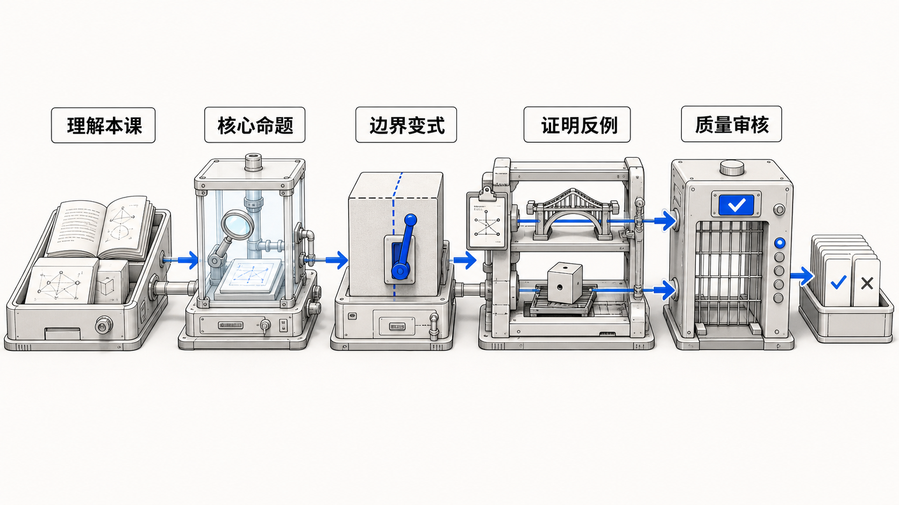

[中文](README.md) | **English**

# Lesson-first Judgment Question SOP (v2.1)



> **Understand what this single lesson teaches—and what it excludes—before generating concise, mathematically rigorous Chinese true/false items that sound like a real classroom teacher speaking at the board.**

`lesson-first-judgment-question-sop` is an open-source Agent Skill (compatible with **Google Antigravity, OpenAI Codex, and Claude Code**) for generating, auditing, and minimally revising true/false judgment questions for Chinese junior-middle-school mathematics.

**Language scope:** Student-facing and teacher-facing outputs are crafted for Chinese middle-school mathematics classrooms. This English README introduces the methodology and architecture to the global open-source community.

---

## What's New in v2.1

| Typical LLM Question Generation Pitfall | How v2.1 Solves It |
| --- | --- |
| Filling fixed quotas ("6 or 8 items") with mechanical number swaps | **Diagnostic-boundary-first + deletion test**: item count emerges naturally from distinct conceptual boundaries |
| Dry definition recall divorced from problem-solving | **Default Dual-Branch Output**: generates both **Knowledge Discrimination** (`≤35` Chinese chars) and **Thinking Discrimination** (`≤55` chars) |
| Repetitive puppet framing ("Xiaoming thinks... His idea is right.") | **De-puppetization rules**: direct reasoning statements for algebraic/geometric steps; bans spoiler narration and repetitive sentence-end tags |
| 70-character legalistic disclaimers & out-of-grade quantifiers ("for all real numbers") | **Single group-header classroom convention + strict lesson lexicon gate** |
| Tautologies after term replacement or robotic scripts bypassing fluency checks | **Anti-tautology circuit breaker + mandatory Read-Aloud Spoken Rewrite Gate** backed by `validate_dual_output.py` |

---

## Default Output Structure

1. **Lesson Profile** — main content, included scope, excluded scope, evidence basis, and readiness status (`READY | PENDING_JUDGMENT | INSUFFICIENT_INPUT`);
2. **Student Version (Dual-Branch)** — clean prose statements (never trapped in layout tables):
   - **Branch 1: Knowledge Discrimination (`KNOWLEDGE`)** — sharp boundary checks on definitions, properties, and rules;
   - **Branch 2: Thinking Discrimination (`STUDENT_THINKING`)** — evaluates whether a concrete step's reasoning holds (`√` items are reserved for counter-intuitive yet valid moves, never textbook recitation);
3. **Teacher Key & Concise Justifications** — `√/×` answers paired with lesson-scoped proofs or concrete counterexamples;
4. **Selection Notes** — flags cross-branch "pick one of two" pairs (plus an optional **Single-Point Drill-Down** mode on request).

---

## Quick Start

Copy the inner `lesson-first-judgment-question-sop` folder into your agent's skills directory:

- **Google Antigravity**: `~/.gemini/config/skills/lesson-first-judgment-question-sop` (Windows: `%USERPROFILE%\.gemini\config\skills\lesson-first-judgment-question-sop`)
- **Codex**: `~/.codex/skills/lesson-first-judgment-question-sop` (Windows: `%USERPROFILE%\.codex\skills\lesson-first-judgment-question-sop`)
- **Claude Code**: `~/.claude/skills/lesson-first-judgment-question-sop` (Windows: `%USERPROFILE%\.claude\skills\lesson-first-judgment-question-sop`)

Then invoke with a lesson title, slides, or teaching notes:

```text
Use lesson-first-judgment-question-sop for Grade 7 "Central Symmetry" (中心对称).
Show the lesson profile first, then output both Knowledge and Thinking branches in natural classroom Chinese without forcing a fixed item quota.
```

---

## Representative v2.1 Examples

| Branch | Chinese Judgment Item | Answer | Lesson-Scoped Justification |
| --- | --- | :---: | --- |
| Knowledge | 把成中心对称的两个图形看成一个整体，这个整体一定是中心对称图形。 | √ | Rotating the combined figure 180° around the symmetry center swaps the two parts, leaving the whole figure invariant. |
| Thinking | 看到两个三角形的三组边分别平行且相等，就可以断定这两个三角形成中心对称。 | × | Counterexample: two triangles related by translation also have three pairs of parallel and equal sides. |
| Thinking | 计算 (2b－a)² 时，小华为了把 a 放到前面，直接改写成 (a－2b)² 来展开。 | √ | Opposites have equal squares: (2b－a)² = [－(a－2b)]² = (a－2b)². |

---

## Validation

Run the zero-dependency validation suite from the repository root:

```bash
python tests/validate_release.py
```

This checks repository structure, frontmatter, JSON schemas, compilation of all four Python scripts, terminology pass/block smoke tests, v2.1 natural-Chinese linter smoke tests (`validate_dual_output.py`), and public privacy boundaries.
